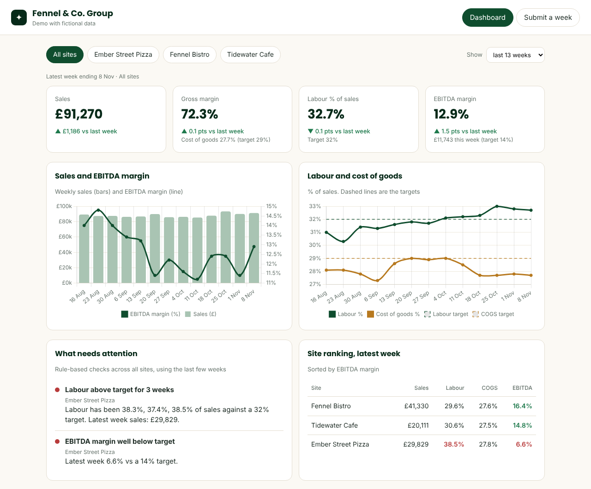
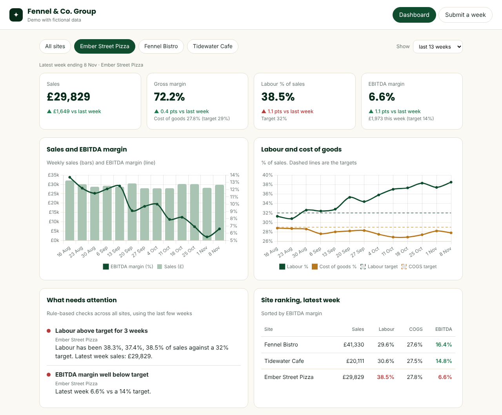
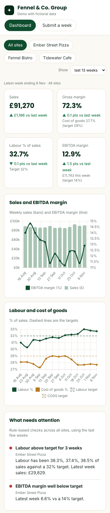
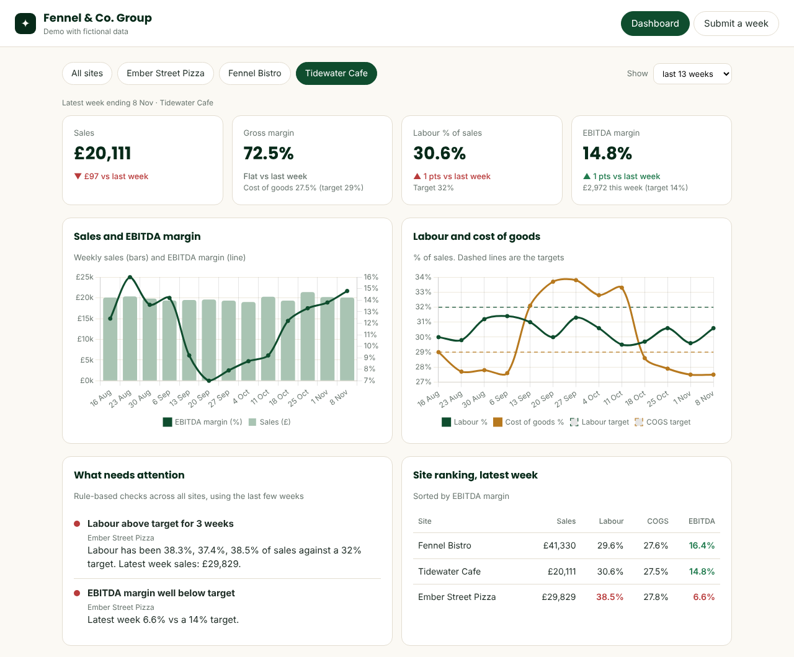

# Weekly P&L Performance Dashboard for Multi-Site Restaurants

A lightweight web app, built on Google Sheets and Google Apps Script, that gives a restaurant group a clear weekly view of sales, margins and labour cost across every site, and lets each site manager submit their own numbers.

> **All data in this repository is fictional.** *Fennel & Co. Group* and its three sites are invented, and every figure is randomly generated (fixed seed, reproducible). This is a portfolio project, not client work.



**Live demo:** https://script.google.com/macros/s/AKfycbyMzc75dI4BYynJJ15PxKmyhxITidL7y9AXTfSFqJVM9LGJr3X8PoR0-Zb_wiZFMH_8AQ/exec

## The problem

Multi-site hospitality owners usually learn how each site performed weeks later, from spreadsheets that every manager formats differently. By the time a labour or food-cost problem is visible, it has already eaten several weeks of margin.

The questions an owner actually needs answered each Monday are simple:

- Which site is doing best and worst this week?
- Is labour or cost of goods drifting away from target?
- Is it a one-off or a trend?

## What it does

| Feature | Why it matters |
|---|---|
| **Single weekly P&L per site**, rolled up to group level | One consistent definition of sales, gross margin, labour % and EBITDA across all sites |
| **KPI cards with week-on-week change** | Shows direction at a glance, coloured by whether the change is good or bad (labour going up is red, sales going up is green) |
| **Trend charts** (sales vs EBITDA margin, labour and COGS vs target) | Separates a bad week from a bad trend |
| **"What needs attention" panel** | Plain, rule-based checks that explain *why* something is flagged |
| **Site ranking** | Sorted by EBITDA margin, with out-of-target cells highlighted |
| **Manager submission form** | Each manager signs in and enters only their own site's week; resubmitting corrects the earlier entry |
| **Mobile friendly** | Managers can submit from a phone, and the dashboard is readable on one |

<table>
  <tr>
    <td></td>
    <td width="220"></td>
  </tr>
  <tr>
    <td align="center"><sub>Single-site view: labour cost climbing past target while sales soften</sub></td>
    <td align="center"><sub>Mobile</sub></td>
  </tr>
</table>

## What the demo data shows

Three situations are planted in the data on purpose, so the dashboard has something real to find:

1. **Ember Street Pizza**: from late August, labour creeps from about 31% to 38% of sales while sales soften. EBITDA margin falls from roughly 16% to under 7%. The dashboard flags this automatically.
2. **Tidewater Cafe**: a five-week spike in food cost (about 28% to 34% of sales) that cut margin roughly in half, then recovered. Visible in the cost chart, and exactly the kind of thing a monthly report would have hidden.
3. **Fennel Bistro**: a steady performer with a pre-Christmas sales lift, used as the healthy benchmark.



## How decisions are supported

The attention panel uses three deliberately simple rules (see `buildInsights_` in `apps-script/Code.gs`):

- Labour above target for **3 weeks running**
- Cost of goods up **2.5+ points** against the previous six weeks
- EBITDA margin more than **4 points below target** in the latest week

Targets (`labourPct`, `cogsPct`, `ebitdaPct`) live in one place at the top of `Code.gs`. I chose transparent rules over anything fancier because a site manager has to trust and understand a flag before they will act on it.

## Architecture

```
Google Sheet (PL_Data, Managers)
        |
Apps Script (Code.gs)   read, aggregate, validate, write
        |
Index.html              Chart.js dashboard + submission form
```

- **Storage:** one row per site per week in `PL_Data`
- **Metrics are calculated, never typed in:** the sheet holds raw inputs only (sales, costs, covers). Margins and percentages are derived in code, so they cannot disagree with each other
- **Writes** are guarded by a script lock, validated server-side (numbers, non-negative, week ending on a Sunday) and replace an existing row for the same site and week instead of duplicating it
- **No build step:** paste two files into Apps Script and deploy

## Run it yourself (about 10 minutes)

1. **Create a Google Sheet** and import `data/pl_data.csv` into a tab named `PL_Data`, and `data/managers.csv` into a tab named `Managers`
   (`File > Import > Upload`, choose *Replace current sheet* or *Insert new sheet*, then rename the tab)
2. In the sheet, open **Extensions > Apps Script**
3. Replace the contents of `Code.gs` with `apps-script/Code.gs`
4. Add an HTML file called `Index` and paste in `apps-script/Index.html`
5. Open **Project Settings**, tick *Show appsscript.json*, and paste in `apps-script/appsscript.json` (or just set the time zone)
6. **Deploy > New deployment > Web app**, then execute as *Me* and choose who has access
7. Open the web app URL

Demo sign-in codes for the submission form (from `data/managers.csv`):

| Email | Code | Site |
|---|---|---|
| alex@fennel-demo.example | `BISTRO-2026` | Fennel Bistro |
| sam@fennel-demo.example | `EMBER-2026` | Ember Street Pizza |
| jo@fennel-demo.example | `TIDE-2026` | Tidewater Cafe |

To regenerate the sample data: `python3 scripts/generate_sample_data.py`

## Known limitations (and what I would change for real use)

Being upfront about these, because they are the difference between a demo and a production tool:

- **Sign-in is demo-grade.** Codes sit in plain text in a sheet. A real deployment should use Google account sign-in (`Session.getActiveUser`) or an identity provider, hash anything stored, and restrict the web app to the organisation
- **The web app is public by default.** `appsscript.json` deploys with access set to *Anyone*, which is fine for fictional data. Change it to your organisation before using real figures
- **No role separation.** In this demo anyone with the link can view every site. A real version needs "manager sees own site, owner sees all"
- **Google Sheets as the database.** Fine for a handful of sites and a few years of weekly rows. Beyond that, move to a proper database
- **Targets are global.** Different formats (café vs full-service) deserve different labour and COGS targets per site
- **Rules, not forecasts.** The flags describe what already happened; they do not predict anything

## Natural next steps

- Recipe-level costing, linking supplier price changes to dish margin (the root cause behind the Tidewater spike)
- Break-even calculator for one-off events such as festivals and caterings
- Per-site access and email alerts when a flag first fires
- Pull sales automatically from the POS instead of manual entry

## Tech

Google Apps Script (V8) &middot; Google Sheets &middot; Chart.js &middot; plain HTML/CSS/JavaScript &middot; Python (sample-data generator, standard library only)

## Author

**Fiorella Rojas**, commercial analyst focused on making financial data simple, visual and actionable.
Part of the [FinProBalance](#) portfolio.

## License

MIT, see [LICENSE](LICENSE).
